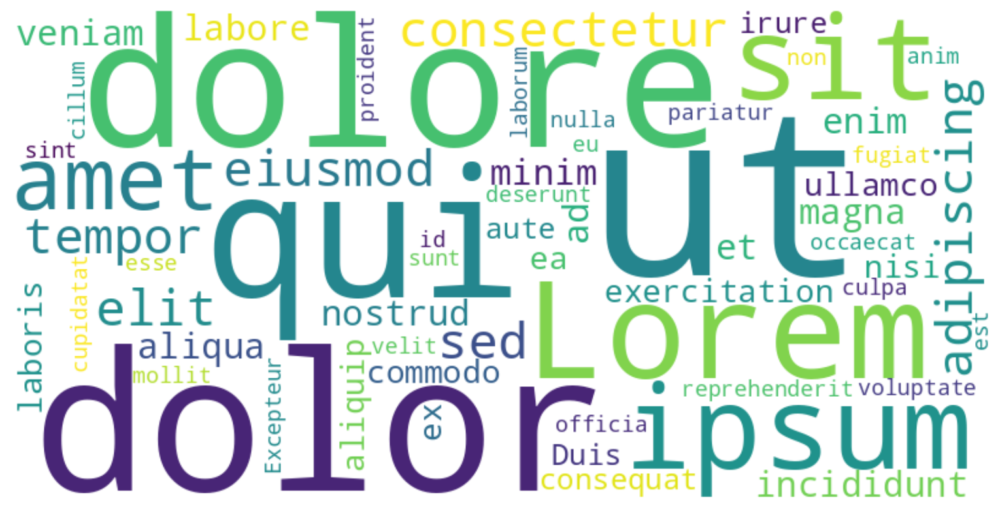

# glogs_wordcloud

Generate word clouds from Google Cloud Logging entries.

This repository contains a Python CLI, infrastructure-as-code for a
least-privilege service account, a hardened container image, and documentation.

## Quick start

```bash
make setup
uv run glogs-wordcloud PROJECT_ID LOG_NAME --num-entries 1000 --output-file out.png
```

## Example



## Repository layout

- `src/glogs_wordcloud/` - Python package and CLI.
- `tests/` - unit tests.
- `docs/` - usage, configuration, security, development, architecture.
- `infra/terraform/` - Terraform for read-only logging IAM.
- `Dockerfile`, `.dockerignore` - container build.
- `Makefile` - lint, test, security, build targets.

## Common commands

```bash
make lint          # ruff + mypy
make test          # pytest
make security      # bandit, pip-audit, trivy, checkov, ...
make docker-build  # build container image
make tf-validate   # terraform fmt + validate
```

## Documentation

See `docs/`.

## Security

See `docs/security.md`. Never commit credentials or `terraform.tfvars`.

## License

Public domain (Unlicense).